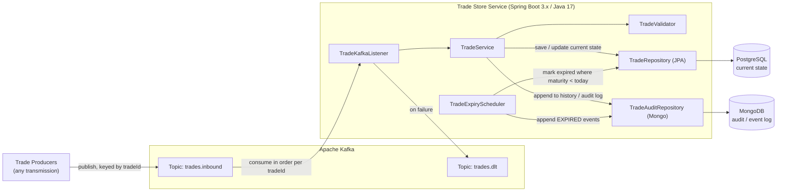
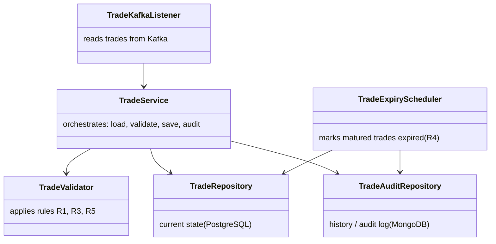

# Trade Store — Mermaid Diagrams

This document captures the high-level system architecture and low-level class diagram from the supplied screenshots.

## 1. High-Level System Architecture

## 2. Low-Level Design — Class Diagram

## Notes

- **R1 — Lower version:** reject an incoming trade when `incoming.version < stored.version`.
- **R2 — Same version:** allow overwrite when `incoming.version == stored.version`.
- **R3 — Past maturity:** reject an incoming trade whose `maturityDate < today`.
- **R4 — Expiry job:** scheduled processing marks trades expired when their maturity date has passed and appends an `EXPIRED` audit event.
- **R5 — Expired trade is terminal:** reject updates to a trade already marked `expired = 'Y'`; do not allow reactivation.
- Kafka messages are keyed by `tradeId` so records for the same trade can be processed in order by a partition.
- PostgreSQL stores the current trade state; MongoDB stores append-only audit/event history.
